<p align="center">
  
</p>

<h1 align="center">WiCare</h1>

<p align="center">
  <b>Fall detection for hospital beds that works from Wi-Fi.</b><br>
  No cameras in the room, nothing for the patient to wear.
</p>

<p align="center">
  <picture>
    <source media="(prefers-reduced-motion: reduce)" srcset="docs/readme/wifi-waves-static.svg">
    
  </picture>
</p>

A patient who falls out of bed at night can lie on the floor for a long time before anyone
walks past. Cameras would catch it, but nobody wants a camera over a hospital bed. WiCare
uses the Wi-Fi that is already in the room instead.

Every Wi-Fi packet reaches the sensor along many paths at once: straight across the room,
off the walls, and through the people in it. When a body moves, those paths change, and the
sensor can measure that change on each of the 52 subcarriers of the signal. WiCare turns it
into a movement score four times a second, looks for the shape of a fall, and alerts the
nurse on the dashboard and by iMessage.

## See it work

<p align="center">
  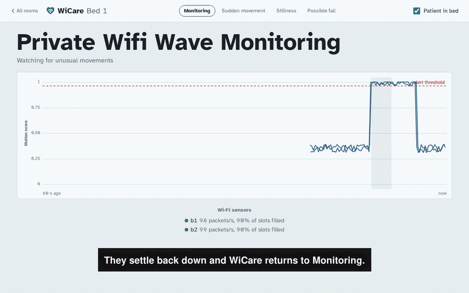
</p>

<p align="center"><a href="docs/readme/wicare-demo.mp4">Watch the full 73-second walkthrough with captions (MP4)</a></p>

## What counts as a fall

A fall is fast and then quiet. Someone who gets up and walks around moves for a long time;
someone who falls moves hard for a moment and then stops. WiCare looks for exactly that:

1. **Sudden movement.** The score crosses the alert threshold and drops back within 3 seconds.
2. **Stillness.** Nothing moves for the next 8 seconds. Any movement cancels the countdown.
3. **Possible fall.** The dashboard sounds a full-screen alarm, and the nurse gets a text:
   reply `1` to acknowledge, `2` to mark a false alarm.

With two sensors, both must see the sudden movement, so someone walking past one sensor
does not start a countdown.

<table>
  <tr>
    <td width="50%">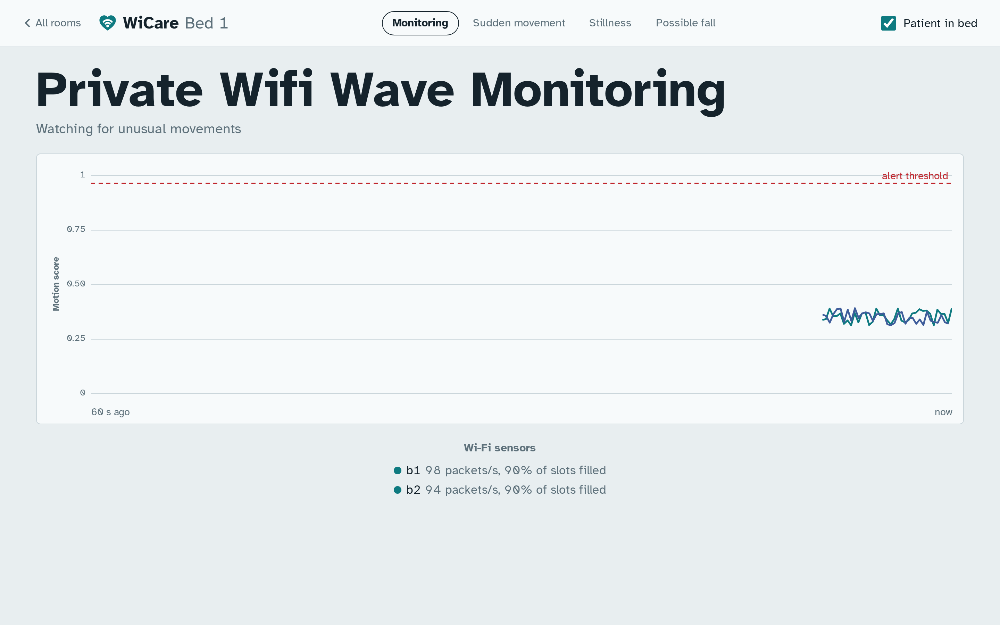</td>
    <td width="50%">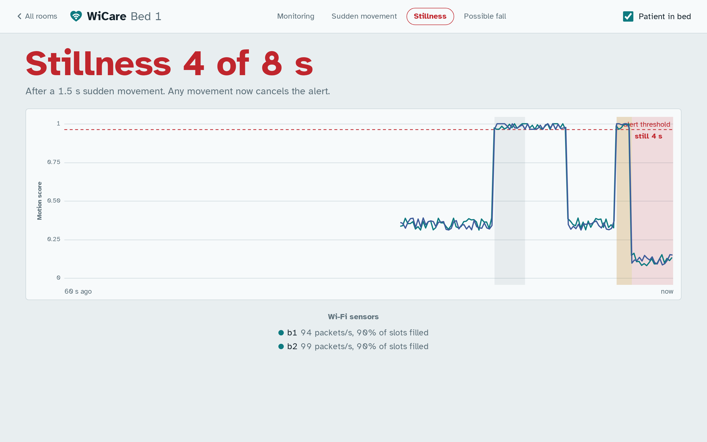</td>
  </tr>
  <tr>
    <td>Resting. The score stays under the dashed alert threshold.</td>
    <td>A short burst, then the stillness count starts.</td>
  </tr>
  <tr>
    <td>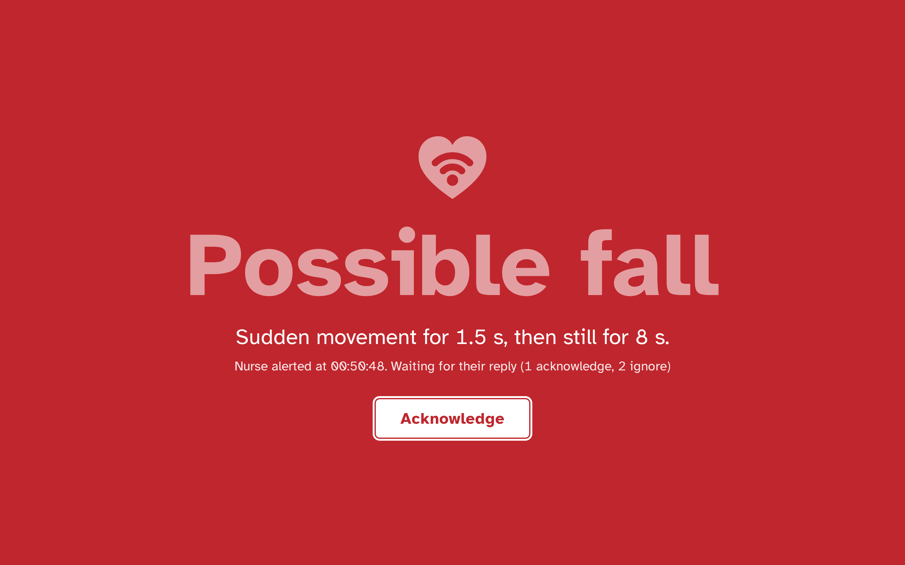</td>
    <td>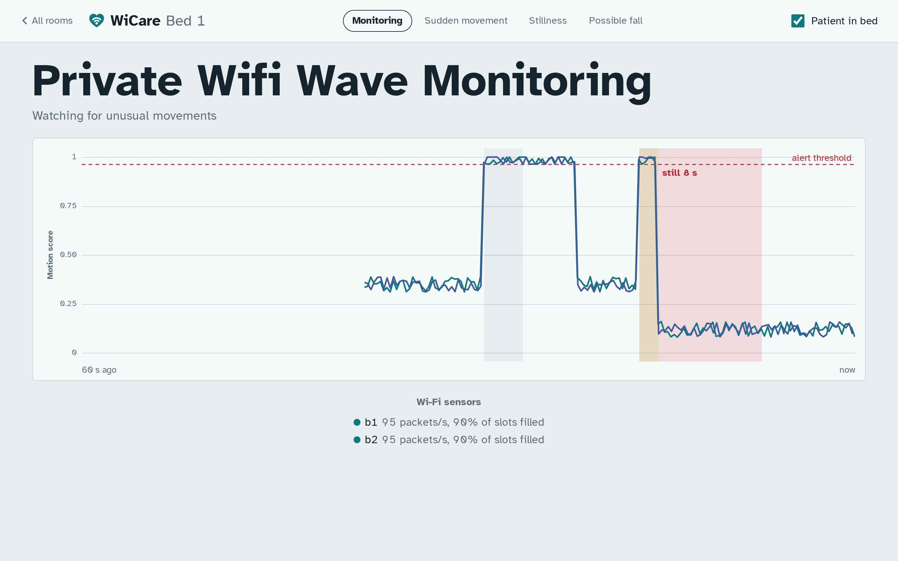</td>
  </tr>
  <tr>
    <td>The alarm says why it fired and whether the nurse has answered.</td>
    <td>After acknowledging, the chart keeps the event marked.</td>
  </tr>
</table>

### And what does not

<table>
  <tr>
    <td width="50%">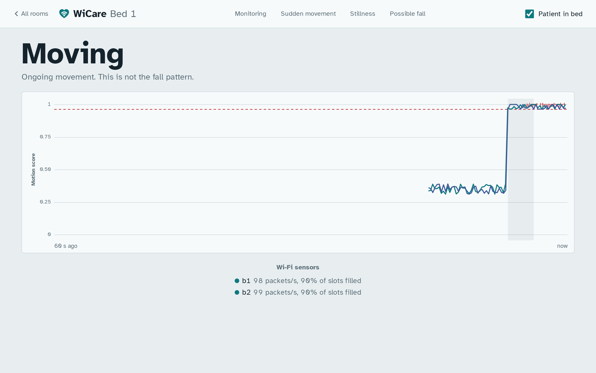</td>
    <td width="50%">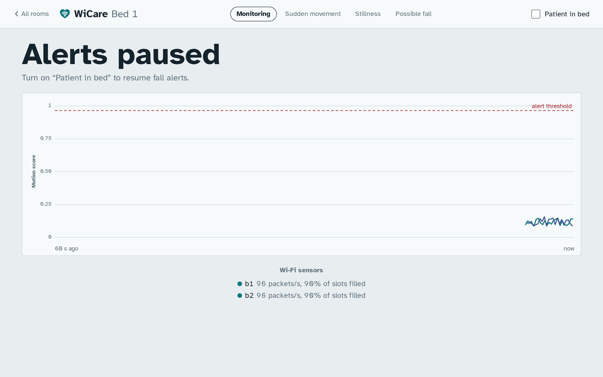</td>
  </tr>
  <tr>
    <td>Walking, getting dressed, a visitor moving around: movement that goes on for more than 3 seconds is not a fall.</td>
    <td>Patient out of the room? Untick <b>Patient in bed</b> and fall alerts pause until it is ticked again.</td>
  </tr>
</table>

## The whole ward at a glance

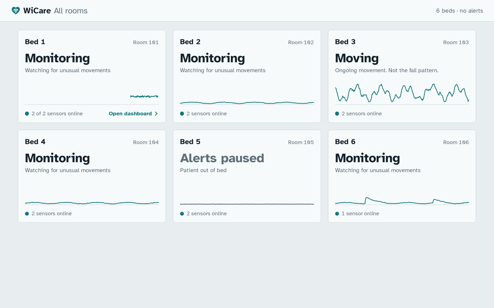

The ward view shows every bed's status and recent movement, and the header turns to an
alert as soon as any bed has a possible fall. Bed 1 is the live sensor setup; the other five
beds show sample data for the demo.

<table>
  <tr>
    <td width="33%">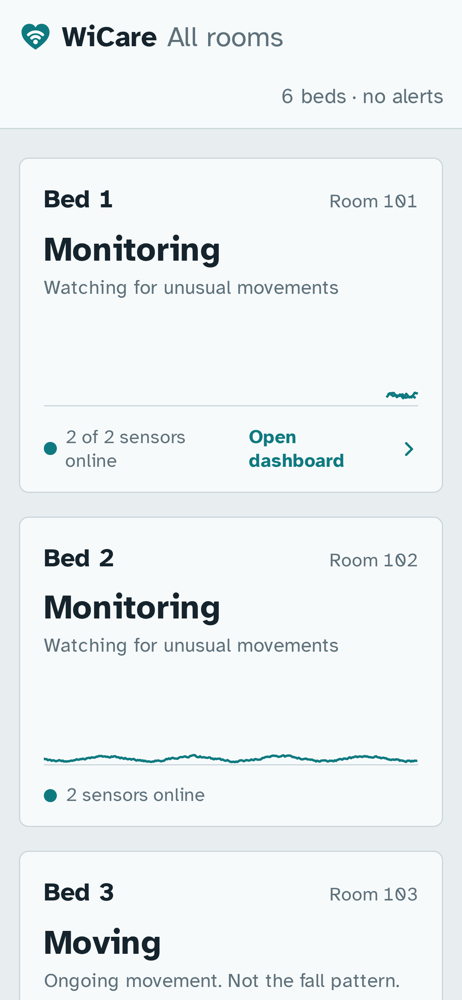</td>
    <td width="33%">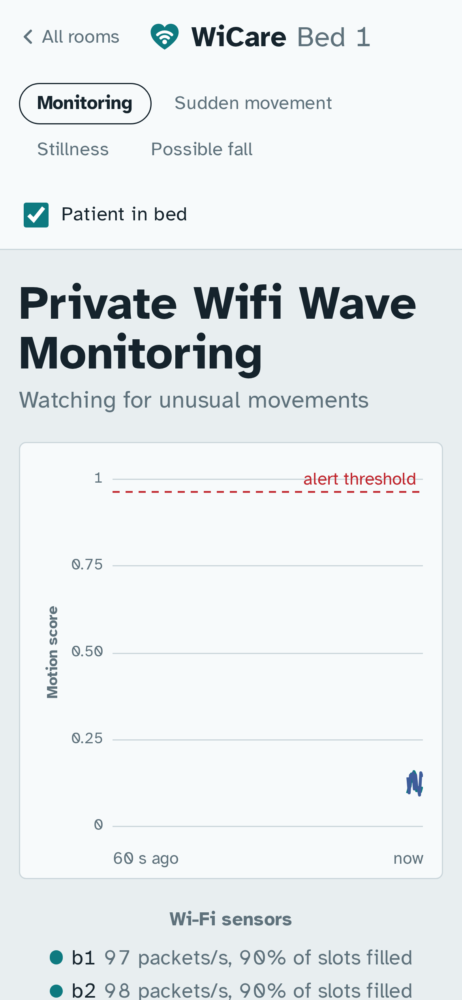</td>
    <td width="33%">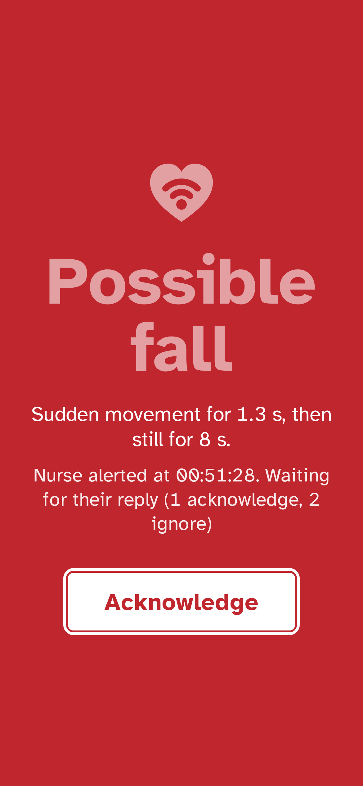</td>
  </tr>
</table>

The dashboard is a web page, so it opens on any phone, tablet or nurses' station screen on
the same network, and it can be installed to a home screen.

## How it is built

```
ESP32 sensors        laptop: fallguard (Python, FastAPI)              nurse

Wi-Fi CSI ─────────▶ motion score, 4 per second
                       ├─▶ fall rule: burst, then stillness ──▶ dashboard alarm
                       └─▶ alert ────▶ Photon ──────────────────▶ iMessage
                           reply ◀──── Photon ◀────────────────── "1" or "2"
```

- **Sensors.** ESP32 boards running [ESPectre](https://github.com/francescopace/espectre)
  Native firmware. Each board measures the channel state information (CSI) of the Wi-Fi link
  and streams a movement score over HTTP. A phone hotspot serves as the access point.
- **App.** `fallguard/` is a Python 3.14 FastAPI app. It reads the score streams, combines
  the sensors, runs the fall rule, and pushes live updates to the dashboard over a WebSocket.
  Every session is recorded so it can be replayed later.
- **Alerts.** A small Node script sends the iMessage through
  [Photon](https://photon.codes), and the app reads the nurse's reply from the same API.
  Alerts have a cooldown, so one fall sends one text.

## Run it

You need Python 3.14, Node, and at least one ESP32 running ESPectre on the same network.

```sh
cd fallguard
python -m venv .venv && . .venv/bin/activate
pip install -e ".[dev]"
cp .env.example .env    # sensor address, alert threshold, nurse phone, Photon keys
python -m fallguard
```

The app prints the dashboard and ward addresses. To try it without hardware, replay a
recorded session:

```sh
python -m fallguard --replay data/sessions/<session>.jsonl
```

Run the tests with `pytest`.

## Limits

WiCare is a hackathon prototype, not a medical device. It notices changes in the radio
signal; it does not see who moved or where they are, and it is tuned for one bed per
sensor pair. A threshold that suits a busy room may need re-tuning in a quiet one.

<p align="center"><sub>Built at HackPrinceton 2026.</sub></p>
